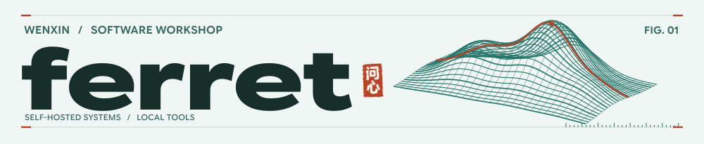
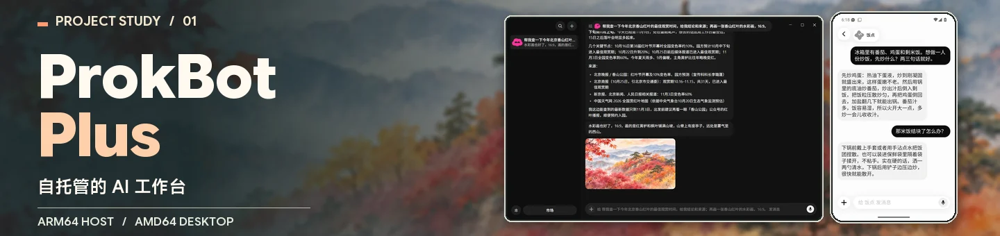

<picture><source media="(prefers-color-scheme: dark)" srcset="./assets/profile/masthead-dark.svg"></picture>

我做自托管 AI 服务，也写离线桌面工具。　[English](https://github.com/ferretgeek/ferretgeek/blob/main/README_EN.md)

<a href="https://github.com/ferretgeek/prokbot-plus"><picture><source media="(max-width: 640px)" srcset="./assets/profile/prokbot-zh-phone.webp"></picture></a>

**[ProkBot Plus](https://github.com/ferretgeek/prokbot-plus)** 把 Grok Bot 的服务端搬到自己的 Linux 机器，接自己选的模型。基于 ProkBot，非官方，仅限非商业使用。

我适配了 Windows 客户端，写了 Android 外壳，并在 Chat Completions 之外接入 **OpenAI Responses 和 Anthropic Messages**。Ampere A1 上的 ARM64 Host 搭配独立 amd64 桌面，已跑通两轮对话和 VNC 操作。

[架构笔记](https://github.com/ferretgeek/prokbot-plus/blob/main/docs/ARCHITECTURE.md) · [Android 实拍](https://github.com/ferretgeek/prokbot-plus/blob/main/docs/images/android-chat-zh.png) · [更新记录](https://github.com/ferretgeek/prokbot-plus/blob/main/CHANGELOG.md)

### 作品选

- **[CPA-X](https://github.com/ferretgeek/cliproxyapi-dashboard)**　`运维`　CLIProxyAPI 在 Linux / systemd 上升级后，健康检查不过就自动回滚。
- **[LLM API Benchmark](https://github.com/ferretgeek/llm-api-benchmark)**　`测量`　首字延迟与输出速度分开测；预热算成本，不算速度。
- **[提示词手账](https://github.com/ferretgeek/prompt-journal)**　`桌面`　用 Tauri 和 SQLite 离线保存每轮提示词，崩溃后还能找回草稿。

[全部仓库](https://github.com/ferretgeek?tab=repositories) · [个人网站](https://ferretgeek.github.io/) · [来信](mailto:ferretgeek@vip.qq.com)
