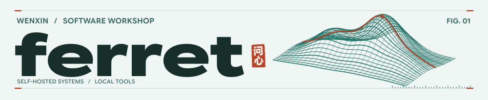
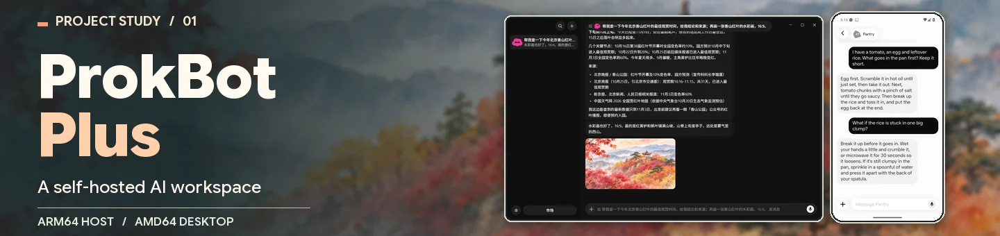

<picture><source media="(prefers-color-scheme: dark)" srcset="./assets/profile/masthead-dark.svg"></picture>

I build self-hosted AI services and offline desktop tools. · [中文](https://github.com/ferretgeek)

<a href="https://github.com/ferretgeek/prokbot-plus"><picture><source media="(max-width: 640px)" srcset="./assets/profile/prokbot-en-phone.webp"></picture></a>

**[ProkBot Plus](https://github.com/ferretgeek/prokbot-plus)** runs the Grok Bot backend on your Linux machine with a model you choose. An unofficial extension of ProkBot for noncommercial use.

I added Windows support, an Android shell, and two model adapters: **OpenAI Responses and Anthropic Messages**. On Ampere A1 hardware, the ARM64 Host and a separate amd64 desktop passed a two-turn chat and a VNC control test.

[Architecture notes](https://github.com/ferretgeek/prokbot-plus/blob/main/docs/ARCHITECTURE.en.md) · [Android screenshot](https://github.com/ferretgeek/prokbot-plus/blob/main/docs/images/android-chat-en.png) · [Changelog](https://github.com/ferretgeek/prokbot-plus/blob/main/CHANGELOG.md)

### Selected tools

- **[CPA-X](https://github.com/ferretgeek/cliproxyapi-dashboard)** · `Operations` · CLIProxyAPI upgrades roll back on Linux/systemd if the new service fails its health check.
- **[LLM API Benchmark](https://github.com/ferretgeek/llm-api-benchmark)** · `Measurement` · Time to first token and output speed are measured separately. Warm-ups count toward cost only.
- **[Prompt Journal](https://github.com/ferretgeek/prompt-journal)** · `Desktop` · A Tauri and SQLite notebook that keeps every prompt revision offline. Drafts survive a crash.

[All repositories](https://github.com/ferretgeek?tab=repositories) · [Personal site](https://ferretgeek.github.io/?lang=en) · [Email](mailto:ferretgeek@vip.qq.com)
